  

 

## 👋 About Me

I'm a cybersecurity professional and software engineer interested in building useful, secure, and maintainable software. My work and learning interests span application security, ethical hacking, penetration testing, full-stack development, and the systems that support modern applications.

I enjoy understanding how software works, identifying weaknesses, and improving the way applications are designed, built, and deployed.

**Areas of focus**
- **Cybersecurity:** penetration testing, ethical hacking, application security, and security fundamentals.
- **Software engineering:** backend and web application development, API integration, and maintainable code.
- **Infrastructure:** Linux environments, databases, deployment workflows, and development tooling.

## 🚀 Featured Projects

<table>
  <tr>
    <td width="50%" valign="top">
      <h3><a href="https://github.com/ExcellenceOseagwina/wellspring-inventory">Wellspring Inventory System</a></h3>
      
A web-based inventory management platform for tracking departmental equipment, monitoring equipment condition, managing user access, and handling media uploads.

      
<strong>Technologies:</strong> HTML, CSS, JavaScript, Node.js, Express, Supabase Auth, PostgreSQL, Supabase Storage, Multer.

      
<strong>Live demo:</strong> <a href="https://wellspring-inventory.vercel.app/">Open application</a> · <a href="https://github.com/ExcellenceOseagwina/wellspring-inventory">Source code</a>

      

        
        
        
        
        
      

    </td>
    <td width="50%" valign="top">
      <h3><a href="https://github.com/ExcellenceOseagwina/WellBot">WellBot</a></h3>
      
A student-support chatbot for Wellspring University, with student registration and email verification, a knowledge-base question matcher, and conversation-history features.

      
<strong>Technologies:</strong> HTML, CSS, JavaScript, Node.js, Express, JWT-based authentication, SMTP email delivery, and Supabase-ready persistence.

      
<strong>Live demo:</strong> <a href="https://wellbot-seven.vercel.app">Open application</a> · <a href="https://github.com/ExcellenceOseagwina/WellBot">Source code</a>

      

        
        
        
        
        
      

    </td>
  </tr>
  <tr>
    <td width="50%" valign="top">
      <h3><a href="https://github.com/ExcellenceOseagwina/smart-farm">SmartFarm</a> (Fork)</h3>
      
A fuzzy-logic-based farm monitoring and decision-support system. Users can record soil moisture, temperature, and humidity readings, receive status assessments and recommendations, and review saved monitoring history.

      
<strong>Technologies:</strong> HTML, CSS, vanilla JavaScript, Node.js, Express 5, Supabase Auth, PostgreSQL, and fuzzy logic.

      
<strong>Live demo:</strong> <a href="https://smart-farm-six-rho.vercel.app">Open application</a> · <a href="https://github.com/ExcellenceOseagwina/smart-farm">Source code</a>

      

        
      

    </td>
    <td width="50%" valign="top">
      <h3><a href="https://github.com/ExcellenceOseagwina/CSC-423">CSC-423</a> (Coursework)</h3>
      
Machine-learning coursework covering house-price prediction, fraud detection with Gaussian Mixture Models, K-Means clustering, customer segmentation, Principal Component Analysis (PCA), digit analysis, and model evaluation.

      
<strong>Technologies:</strong> Python, Jupyter, NumPy, pandas, Matplotlib, and scikit-learn.

      
<strong>Project materials:</strong> <a href="https://csc-423.vercel.app">Coursework site</a> · <a href="https://github.com/ExcellenceOseagwina/CSC-423">Source code and notebooks</a>

      

        
        
        
      

    </td>
  </tr>
  <tr>
    <td width="50%" valign="top">
      <h3><a href="https://github.com/ExcellenceOseagwina/python-practice-for-beignners">Python Practice for Beginners</a></h3>
      
A hands-on Python learning repository containing beginner-friendly exercises and console projects covering variables, data types, user input, operators, conditionals, loops, and introductory functions.

      
<strong>Technologies:</strong> Python 3 and the Python standard library.

      
<strong>Source code:</strong> <a href="https://github.com/ExcellenceOseagwina/python-practice-for-beignners">View repository</a>

      

        
      

    </td>
    <td width="50%" valign="top">
      <h3><a href="https://github.com/ExcellenceOseagwina/xl-project">XL Project</a></h3>
      
A small Python/openpyxl workbook-processing project that reads transaction data and explores calculating a 10% price adjustment and generating a bar chart.

      
<strong>Technologies:</strong> Python, openpyxl.

      
<strong>Source code:</strong> <a href="https://github.com/ExcellenceOseagwina/xl-project">View repository</a>

      

        
        
      

    </td>
  </tr>
  <tr>
    <td width="50%" valign="top">
      <h3><a href="https://github.com/ExcellenceOseagwina/my_Portfolio">My Portfolio</a></h3>
      
A personal portfolio website presenting professional information, skills, and selected projects through a responsive web interface.

      
<strong>Technologies:</strong> HTML, CSS, JavaScript.

      
<strong>Website:</strong> <a href="https://excellence.oseagwinaexcellence.workers.dev/">Visit portfolio</a> · <a href="https://github.com/ExcellenceOseagwina/my_Portfolio">Source code</a>

      

        
        
        
      

    </td>
    <td width="50%" valign="top">
      <h3><a href="https://github.com/ExcellenceOseagwina/Naga-Portfolio">Nagasaki Designs — Graphic &amp; Product Design Portfolio</a></h3>
      
A portfolio website for a Nigerian graphic and product designer, presenting selected creative work and services including logo design, brand identity, UI/UX design, promotional flyers, product mockups, and illustration.

      
<strong>Technologies:</strong> HTML5, CSS3, JavaScript, Font Awesome, and Devicon.

      
<strong>Website:</strong> <a href="https://naga-portfolio-nine.vercel.app/">Visit portfolio</a> · <a href="https://github.com/ExcellenceOseagwina/Naga-Portfolio">Source code</a>

      

        
        
        
      

    </td>
  </tr>
</table>

## 📊 GitHub Stats

### `$ cat ~/stats.log`

### 📈 Coding Activity

---

## 🤝 Connect

  
  
  
  
  
  

## 🎬 Off the Clock

Anime, manga, comics, video games, and exploring how things work, fail, and improve.
