 

   

## 🚀 Featured Projects
<table>
  <tr>
    <td width="50%" valign="top">
      <h3><a href="https://github.com/ExcellenceOseagwina/wellspring-inventory">Wellspring Inventory System</a></h3>
      
Web-based platform for digitally managing departmental equipment, featuring user authentication, inventory tracking, equipment condition monitoring and media uploads.

      

        
        
        
        
      

    </td>
    <td width="50%" valign="top">
      <h3><a href="https://github.com/ExcellenceOseagwina/WellBot">WellBot</a></h3>
      
Web-based student support chatbot developed for Wellspring University, providing university-related information through an NLP-style conversational interface with user authentication and conversation history.

      

        
        
        
        
      

    </td>
  </tr>
  <tr>
    <td width="50%" valign="top">
      <h3><a href="https://github.com/ExcellenceOseagwina/smart-farm">SmartFarm</a> (Fork)</h3>
      
Fuzzy-logic-based agricultural monitoring system that analyzes environmental conditions, evaluates farm health and provides recommendations to support agricultural decision-making.

      

        
      

    </td>
    <td width="50%" valign="top">
      <h3><a href="https://github.com/ExcellenceOseagwina/CSC-423">CSC-423</a> (Coursework)</h3>
      
Machine learning coursework project exploring supervised and unsupervised learning techniques through practical applications, including house price prediction, fraud detection, customer segmentation, K-Means clustering, Gaussian Mixture Models (GMM), Principal Component Analysis (PCA) and digit analysis.

      

        
        
        
      

    </td>
  </tr>
</table>

 

## 📊 GitHub Stats

<!-- ============================================================
     GITHUB STATS BLOCK | user: ExcellenceOseagwina
     Theme: Terminal Green (#00FF41) on GitHub Dark (#0D1117)
     ============================================================ -->

### `$ cat ~/stats.log`

<!-- ROW 1: GitHub Streak -->

## 🤝 Connect

  
  
  
  
  
  

## 🎬 Off the Clock

Anime, manga and comics, video games, and taking apart how things work, fail and improve.

 

