<!-- HEADER BANNER -->

  
  

  

---
# 👨‍💻 About Me

## Excellence Oseagwina

**Cybersecurity Professional | Penetration Tester | Software Developer**  
**Wellspring University, Benin City, Edo State, Nigeria**

  

---

I am a Cybersecurity professional and Software Developer with a Bachelor of Science degree in Cyber Security from Wellspring University.

My interests and experience span cybersecurity, ethical hacking, penetration testing, software development, full-stack web development, backend engineering and database management. I enjoy building practical software solutions, understanding how systems work, identifying security vulnerabilities and developing secure, reliable applications. I am passionate about continuous learning, problem-solving and exploring the intersection between cybersecurity and software engineering.

- 🎓 **Degree / Field:** Bachelor of Science (B.Sc.) in Cyber Security
- 🏫 **Education:** Wellspring University · Graduate, 2026
- 📍 **Location:** Benin City, Edo State, Nigeria
- 🛡️ **Professional Membership:** Computer Professionals Registration Council of Nigeria (CPN) · Inducted Member, October 21, 2026
- 🎯 **Focus Areas:** Ethical Hacking, Penetration Testing, Software Development, Backend Engineering and Database Management
- 📬 **Contact:** [oseagwinaexcellence@gmail.com](mailto:oseagwinaexcellence@gmail.com)

<!-- SOCIAL / PROFILE BADGES -->

---

  <h2 style="font-size: 28px !important; font-weight: bold; margin: 0 0 5px 0; line-height: 1.5;">
    🌐 Socials:
  </h2>
  

  
  
  
  

---
## 🚀 Featured Projects

<table>
  <tr>
    <td width="50%" valign="top">
      <h3>🐍 <a href="https://github.com/ExcellenceOseagwina/python-practice-for-beignners">Python Practice for Beginners</a></h3>
      
A Python learning repository containing practical exercises and programming practice for beginners.

      

    </td>
    <td width="50%" valign="top">
      <h3>🌐 <a href="https://github.com/ExcellenceOseagwina/Naga-Portfolio">Naga Portfolio</a></h3>
      
A personal portfolio website showcasing web development and design.

      

    </td>
  </tr>
  <tr>
    <td width="50%" valign="top">
      <h3>📘 <a href="https://github.com/ExcellenceOseagwina/CSC-423">CSC-423</a></h3>
      
An academic computer science project.

      

    </td>
    <td width="50%" valign="top">
      <h3>🌱 <a href="https://github.com/ExcellenceOseagwina/smart-farm">SmartFarm</a></h3>
      
A <b>forked repository</b> for a smart agriculture project using fuzzy logic and software technologies.

      

    </td>
  </tr>
  <tr>
    <td width="50%" valign="top">
      <h3>🤖 <a href="https://github.com/ExcellenceOseagwina/WellBot">WellBot</a></h3>
      
A chatbot project.

      

    </td>
    <td width="50%" valign="top">
      <h3>📦 <a href="https://github.com/ExcellenceOseagwina/wellspring-inventory">Wellspring Inventory Management System</a></h3>
      
A university inventory management system.

      

        
        
        
        
        
      

    </td>
  </tr>
</table>

---

## Tech Stack

**Programming Languages**

  
  
  
  
  

**Backend Development &amp; Data**

  
  
  
  
  
  
  

**Cybersecurity**

  
  
  
  
  
  
  
  
  

**Development Tools**

  
  
  
  

**Cybersecurity Tools &amp; Platforms**

  
  
  

**Cloud &amp; Deployment**

  
  

---

## GitHub Stats

<table border="0" cellspacing="0" cellpadding="5">
  <tr>
    <td align="center" width="50%">
      
    </td>
    <td align="center" width="50%">
      
    </td>
  </tr>
</table>

 

---

## 💻 Contribution Activity

  

<picture>
  <source media="(prefers-color-scheme: dark)" srcset="./assets/excellence-oseagwina-contribution-grid-snake-dark.svg" />
  <source media="(prefers-color-scheme: light)" srcset="./assets/excellence-oseagwina-contribution-grid-snake.svg" />
  
</picture>

---

  

---

### Thanks for visiting my profile!

**Continuous learning · Practical security · Secure software**

 

<svg fill="none" width="800" height="90" viewBox="0 0 800 90" xmlns="http://www.w3.org/2000/svg">
  <defs>
    <linearGradient id="footer-grad" x1="0%" y1="0%" x2="100%" y2="0%">
      <stop offset="0%" stop-color="#4a8be2" />
      <stop offset="50%" stop-color="#55759e" />
      <stop offset="100%" stop-color="#424c57" />
    </linearGradient>
  </defs>
  <path d="M0 40 Q 200 10, 400 35 T 800 25 L 800 90 L 0 90 Z" fill="url(#footer-grad)" opacity="0.6" />
  <path d="M0 55 Q 250 25, 500 45 T 800 35 L 800 90 L 0 90 Z" fill="url(#footer-grad)" />
</svg>

  

