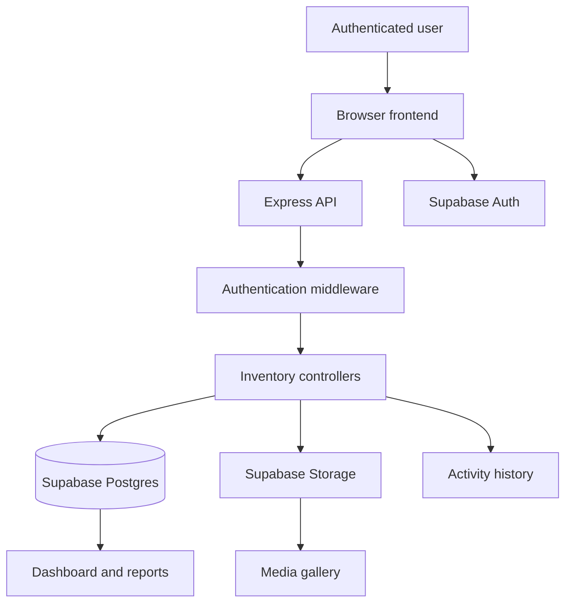
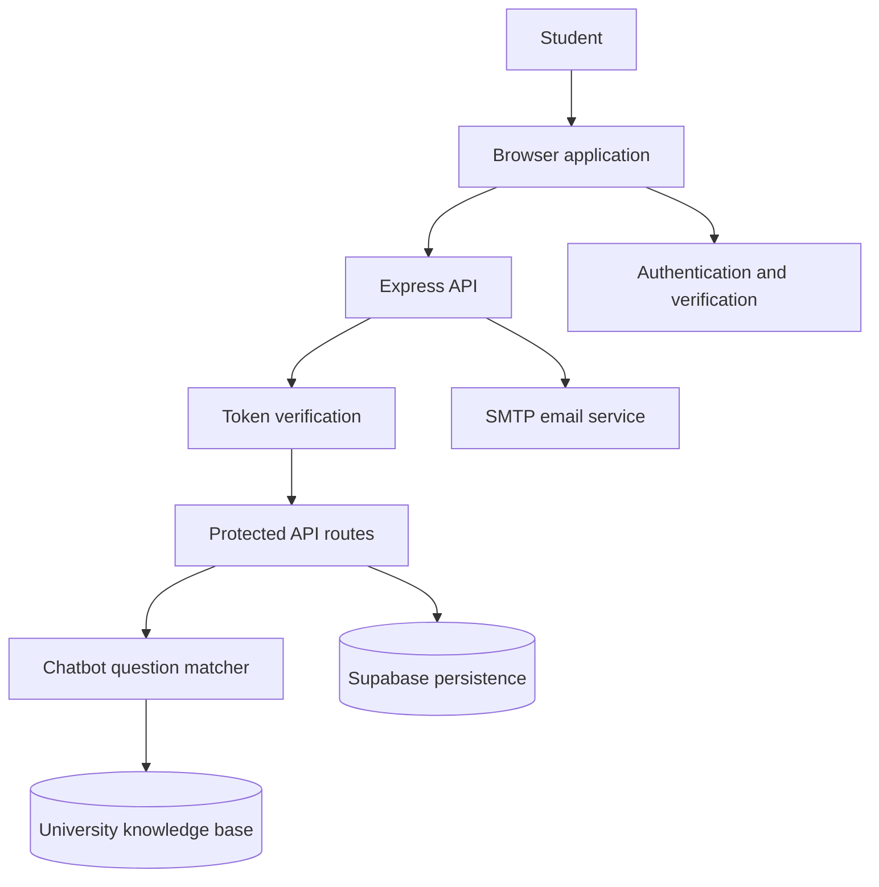
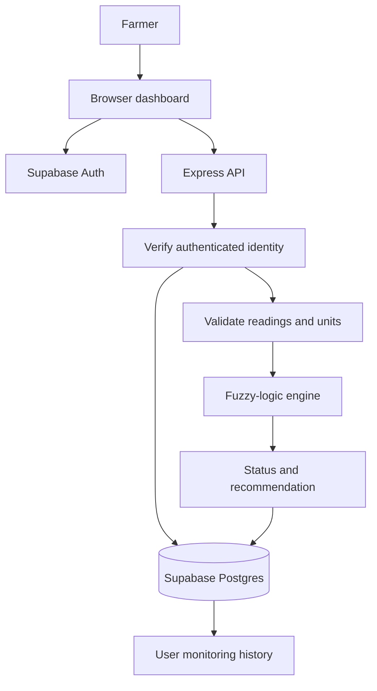
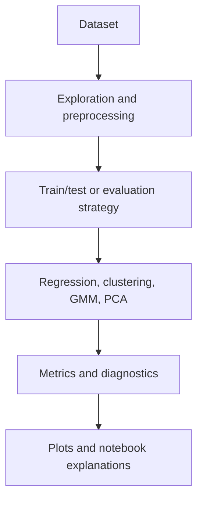

# Project Architecture

These diagrams are high-level logical views based on each project's documented components. They are not generated from runtime traces and should be updated when implementation details change.

## Wellspring Inventory System

**Trust boundaries:** the browser is untrusted; API authorization must be enforced server-side. Storage policies and database policies must independently protect user and departmental data. Service-role credentials must remain server-side.

## WellBot

**Trust boundaries:** authenticate and authorize each request; do not trust student identifiers supplied in request bodies. Conversation history must be scoped to the authenticated student. Knowledge-base answers should be reviewed against authoritative university information.

## SmartFarm

**Trust boundaries:** derive user identity from a verified token, validate every measurement server-side, and enforce row ownership in database policies. Do not treat client-provided `userId` values as proof of identity.

## CSC-423 coursework

**Reproducibility:** record dataset sources, dependency versions, random seeds, preprocessing steps, and evaluation methodology. Keep test data out of model fitting and preprocessing statistics.
